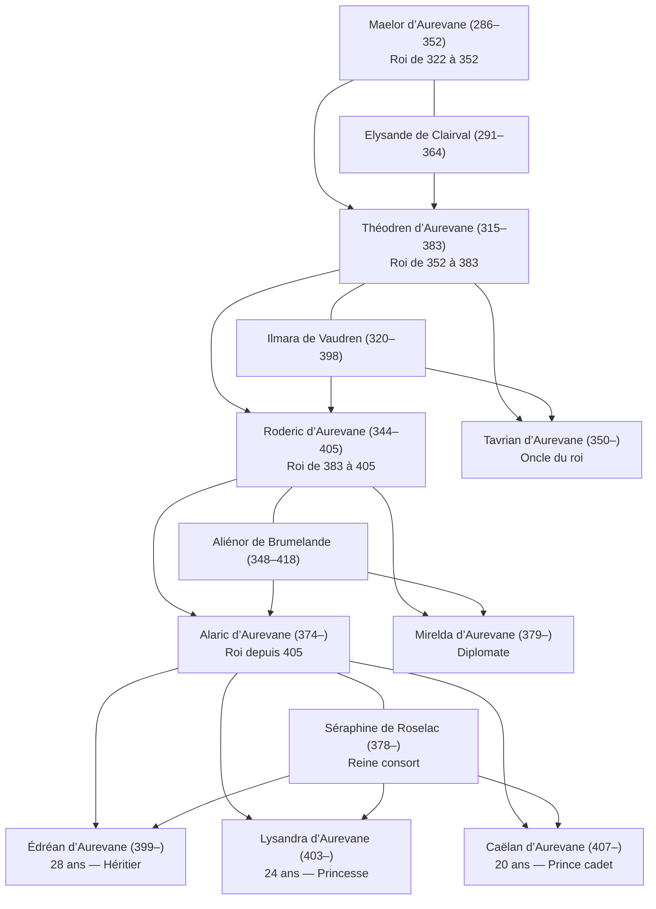

# Maison d’Aurevane — Dossier généalogique et descriptif

> [!important] Référence officielle du Fondateur
> Ce dossier crée **la dynastie d'Aurevane**, famille royale de [[Aethérion|Tharvélis]], sur trois générations précédant le souverain actuel. Il contient la filiation, les dates de règne, les caractères et les **13 descriptions détaillées de personnages**, dont deux représentants de branches collatérales.
>
> **Correction impérative : [[Caëlan d’Aurevane]] a 20 ans en 427 et est né en 407** — ni 17 ans ni 410. Cette version prime toute mention antérieure.
>
> Ces noms et biographies deviennent des **références nouvellement créées de l'univers**, sans transformer leur passé en événements vécus par Soren. L'**audience prévue à J+20** n'est pas encore jouée à l'arrêt J+15. Les secrets de Soren ne deviennent pas automatiquement connus du roi.

**Royaume :** Tharvélis · **Capitale :** [[Aethérion]] · **Dynastie :** Maison d'Aurevane · **Roi actuel :** [[Alaric d’Aurevane]] · **Résidence :** [[Château royal d’Aethérion]].

## Arbre généalogique officiel

*Les couples sont reliés horizontalement, les parents à leurs enfants par des flèches verticales. Les trois enfants du roi actuel sont Édréan, Lysandra et Caëlan, dans cet ordre.*

## Les quatre souverains successifs

| Souverain | Vie | Règne | Portrait historique |
|---|---|---|---|
| [[Maelor d’Aurevane]] | 286–352 | 322–352 | Roi de Fer, défense et discipline |
| [[Théodren d’Aurevane]] | 315–383 | 352–383 | Roi érudit, études, commerce et culture |
| [[Roderic d’Aurevane]] | 344–405 | 383–405 | Roi vigilant, sécurité et organisation |
| **[[Alaric d’Aurevane]]** | Né en 374 | Depuis 405 | Roi actuel, négociation et pragmatisme |

**Reines successives :** [[Elysande de Clairval]], [[Ilmara de Vaudren]], [[Aliénor de Brumelande]], [[Séraphine de Roselac]].

## Famille royale vivante en 427

| Personnage | Âge | Race | Rôle |
|---|---:|---|---|
| **[[Alaric d’Aurevane]]** | 53 | Humain | Roi |
| **[[Séraphine de Roselac]]** | 49 | Demi-Elfe | Reine consort |
| **[[Édréan d’Aurevane]]** | 28 | Humain d'ascendance elfique maternelle | Prince héritier |
| **[[Lysandra d’Aurevane]]** | 24 | Humaine d'ascendance elfique maternelle | Princesse royale |
| **[[Caëlan d’Aurevane]]** | **20** | Humain d'ascendance elfique maternelle | Prince cadet |
| [[Mirelda d’Aurevane]] | 48 | Humaine | Sœur du roi, diplomate |
| [[Tavrian d’Aurevane]] | 77 | Humain | Oncle du roi, ancien conseiller |

## Portraits officiels de la famille actuelle

Les cinq portraits sont les **références visuelles officielles** du roi Alaric, de la reine Séraphine et de leurs trois enfants. **Caëlan a 20 ans**, né en **407**. Aucun portrait n'ajoute de scène ou de connaissance à Soren.

| Personnage | Identité | Image |
|---|---|---|
| **[[Alaric d’Aurevane]]** | roi de Tharvélis · 53 ans | [Portrait officiel](../../08%20%E2%80%94%20Illustrations/Personnages/Alaric%20d%E2%80%99Aurevane/Alaric%20d%E2%80%99Aurevane%20%E2%80%94%20Portrait%20officiel.webp) |
| **[[Séraphine de Roselac]]** | reine consort de Tharvélis · 49 ans | [Portrait officiel](../../08%20%E2%80%94%20Illustrations/Personnages/S%C3%A9raphine%20de%20Roselac/S%C3%A9raphine%20de%20Roselac%20%E2%80%94%20Portrait%20officiel.webp) |
| **[[Édréan d’Aurevane]]** | prince héritier · 28 ans | [Portrait officiel](../../08%20%E2%80%94%20Illustrations/Personnages/%C3%89dr%C3%A9an%20d%E2%80%99Aurevane/%C3%89dr%C3%A9an%20d%E2%80%99Aurevane%20%E2%80%94%20Portrait%20officiel.webp) |
| **[[Lysandra d’Aurevane]]** | princesse royale · 24 ans | [Portrait officiel](../../08%20%E2%80%94%20Illustrations/Personnages/Lysandra%20d%E2%80%99Aurevane/Lysandra%20d%E2%80%99Aurevane%20%E2%80%94%20Portrait%20officiel.webp) |
| **[[Caëlan d’Aurevane]]** | prince cadet · 20 ans | [Portrait officiel](../../08%20%E2%80%94%20Illustrations/Personnages/Ca%C3%ABlan%20d%E2%80%99Aurevane/Ca%C3%ABlan%20d%E2%80%99Aurevane%20%E2%80%94%20Portrait%20officiel.webp) |

## Règles de succession et relations

La **primogéniture sans distinction de sexe** organise la succession parmi les trois enfants du souverain :
1. **[[Édréan d’Aurevane]]**, prince héritier.
2. **[[Lysandra d’Aurevane]]**, princesse royale.
3. **[[Caëlan d’Aurevane]]**, prince cadet, **20 ans**.

[[Mirelda d’Aurevane]] et [[Tavrian d’Aurevane]] appartiennent aux **branches collatérales** ; leur place éventuelle lors d'une succession exceptionnelle reste à préciser. **Aucun conflit, complot ni rivalité hostile n'est créé automatiquement.**

## Identité visuelle et cadre familial

La famille principale présente des traits de parenté plausibles, des **chevelures souvent brunes ou châtain et des yeux clairs**. Les trois enfants possèdent une **ascendance elfique maternelle** provenant de Séraphine, exprimée différemment selon chacun. **Aucun pouvoir, bonus racial ou niveau n'est accordé par simple description.**

La résidence familiale est le **[[Château royal d’Aethérion]]**, dans la citadelle centrale de la capitale. Le roi, la reine et leurs trois enfants disposent de pièces privées ; Mirelda de logements de fonction lors de ses séjours, Tavrian d'appartements confortables. **L'emplacement de chaque chambre reste ouvert.**

> [!warning] Homonymes
> La princesse **[[Lysandra d’Aurevane]]** est **distincte de [[Lysandra]]**, vendeuse elfe d'une boutique magique rencontrée par Soren. Ne jamais les fusionner.

**Note narrative :** L'identité du souverain, de la dynastie et des héritiers est maintenant définie pour le monde ; les résultats de l'audience de J+20, les connaissances des PNJ et les secrets de Soren restent à découvrir en jeu.

---

# Fiches descriptives complètes des treize membres

Les chapitres suivants reprennent les détails des **fiches individuelles** (physique, coiffure, regard, vêtements, comportement, défauts, passé et famille) qui serviront à créer les portraits officiels.

## 1. Maelor d’Aurevane

**Fiche liée :** [[Maelor d’Aurevane]]

**Rôle :** Roi de Tharvélis de 322 à 352  
**Dates :** 286–352 · Décédé en 352, vers 66 ans  
**Race :** Humain  
**Taille :** 1,89 m · **Poids :** 96 kg  
**Génération :** −3  
**Famille :** Époux d’[[Elysande de Clairval]] ; père de [[Théodren d’Aurevane]].

### Apparence physique et constitution
Maelor était **grand, imposant et très robuste**, avec des épaules puissantes, un torse large et des bras solides. Il conservait une posture extrêmement droite jusque dans les dernières années de sa vie. Son **visage rectangulaire**, sa mâchoire large et son nez légèrement aquilin donnaient à ses traits une grande fermeté. Ses **yeux bleu acier**, sous d'épais sourcils noirs, exprimaient une vigilance constante. Ses cheveux, initialement noirs, étaient devenus presque entièrement **gris** à la fin de son règne ; il portait une **barbe courte et assez fournie, gris argenté**. Une cicatrice fine traversait sa **joue droite**, sans origine connue.

### Vêtements et représentation
Il privilégiait des manteaux de **velours bleu nuit**, des tuniques épaisses et des bordures argentées. Sa couronne de cérémonie était relativement sobre, en métal doré, plutôt qu'un assemblage excessivement chargé de gemmes. Sa silhouette doit exprimer la puissance du souverain et la discipline d'un homme d'État.

### Personnalité et comportement
Maelor était **autoritaire, discipliné, courageux et pragmatique**. Pour lui, la première responsabilité du souverain était la sécurité du royaume. Il respectait la loyauté, les engagements et la parole donnée. Il pouvait toutefois se montrer **inflexible**, éprouver de la difficulté à reconnaître publiquement une erreur et être sévère envers les personnes qui le décevaient. Sa manière de gouverner reposait sur la **stabilité et la défense**, bien davantage que sur la recherche de prestige.

### Héritage dynastique
Surnommé **l'ancien roi de Fer**, il laissa l'image d'un souverain solide mais peu démonstratif. Son fils [[Théodren d’Aurevane]] grandit avec une conception exigeante de la fonction royale. Ce portrait appartient au **nouvel arrière-plan dynastique inventé par le Fondateur**, pas à un événement vécu par Soren.

### Liens et référence
**Généalogie complète :** [[Maison d’Aurevane — Généalogie royale]] · **Résidence de la dynastie :** [[Château royal d’Aethérion]] · **Capitale :** [[Aethérion]].

---

## 2. Elysande de Clairval

**Fiche liée :** [[Elysande de Clairval]]

**Rôle :** Reine consort de 322 à 352  
**Dates :** 291–364 · Décédé en 364, vers 73 ans  
**Race :** Humaine  
**Taille :** 1,72 m · **Poids :** 65 kg  
**Génération :** −3  
**Famille :** Épouse de [[Maelor d’Aurevane]] ; mère de [[Théodren d’Aurevane]].

### Apparence physique et constitution
Elysande possédait une **silhouette élégante**, les épaules relativement fines et une posture naturellement droite. Son visage était **ovale**, avec des pommettes un peu hautes et un menton délicat. Ses **yeux vert émeraude**, particulièrement expressifs, contrastaient avec ses cheveux **châtain auburn**, longs, généralement tressés ou relevés. Avec les années, sa chevelure passa des reflets cuivrés à des nuances argentées.

### Vêtements et représentation
Elle affectionnait les robes longues **vert profond, crème ou bordeaux**, rehaussées de broderies discrètes. Elle portait peu de bijoux, à l'exception de quelques pièces familiales choisies pour leur qualité plutôt que leur taille. L'image doit traduire une reine posée, raffinée mais sans ostentation.

### Personnalité et comportement
Elysande était **intelligente, diplomate, patiente et très observatrice**. Contrairement à Maelor, elle cherchait volontiers à résoudre les tensions par la discussion. Dotée d'une excellente mémoire des personnes et des conversations, elle pouvait exprimer son désaccord sans élever la voix. Sa limite la plus marquée était sa volonté **d'anticiper toutes les difficultés** : il lui arrivait d'intervenir trop tôt dans les décisions de ses proches.

### Héritage dynastique
Elle représentait une **présence stabilisatrice** dans la famille. Son fils [[Théodren d’Aurevane]] hérita de son intérêt pour la diplomatie et l'étude. Elle continua à vivre jusqu'en **364**, douze ans après la mort de Maelor.

### Liens et référence
**Généalogie complète :** [[Maison d’Aurevane — Généalogie royale]] · **Résidence de la dynastie :** [[Château royal d’Aethérion]] · **Capitale :** [[Aethérion]].

---

## 3. Théodren d’Aurevane

**Fiche liée :** [[Théodren d’Aurevane]]

**Rôle :** Roi de Tharvélis de 352 à 383  
**Dates :** 315–383 · Décédé en 383, vers 68 ans  
**Race :** Humain  
**Taille :** 1,86 m · **Poids :** 84 kg  
**Génération :** −2  
**Famille :** Fils de [[Maelor d’Aurevane]] et [[Elysande de Clairval]] ; époux d’[[Ilmara de Vaudren]] ; père de [[Roderic d’Aurevane]] et [[Tavrian d’Aurevane]].

### Apparence physique et constitution
Théodren était **grand et élancé**, moins musclé que son père Maelor. Il avait le visage **allongé**, le nez droit et des traits plus doux. Ses yeux **bleu gris clair** lui donnaient un regard réfléchi. Ses cheveux, jadis **châtain clair**, étaient devenus **gris argenté** avec l'âge. Il entretenait une barbe courte, soigneusement taillée. Ses mains longues et ses doigts fins accompagnaient une gestuelle calme et précise.

### Vêtements et représentation
Il préférait des vêtements de cour élégants mais confortables : tuniques **bleu ardoise, beiges ou grises**, manteaux à motifs brodés et pièces d'apparat mesurées. Son allure doit évoquer davantage un souverain lettré qu'un monarque guerrier.

### Personnalité et comportement
Théodren était **cultivé, réfléchi, patient et curieux**. Il lisait et discutait volontiers avec les érudits, artisans et personnes possédant un savoir particulier. Il rechignait à décider avant d'avoir étudié plusieurs possibilités. Cette prudence pouvait devenir **une hésitation excessive**, qui retardait les réponses du gouvernement. En privé, il demeurait relativement chaleureux et accessible.

### Règne et héritage
Surnommé **le roi érudit**, Théodren est associé dans la chronique familiale au **commerce, aux bibliothèques et aux relations entre communautés**. Il transmit à [[Roderic d’Aurevane]] le respect des institutions, même si celui-ci développa un caractère plus martial. Son frère cadet, [[Tavrian d’Aurevane]], naquit en 350, à la fin du règne de Maelor.

### Liens et référence
**Généalogie complète :** [[Maison d’Aurevane — Généalogie royale]] · **Résidence de la dynastie :** [[Château royal d’Aethérion]] · **Capitale :** [[Aethérion]].

---

## 4. Ilmara de Vaudren

**Fiche liée :** [[Ilmara de Vaudren]]

**Rôle :** Reine consort de 352 à 383  
**Dates :** 320–398 · Décédé en 398, vers 78 ans  
**Race :** Humaine  
**Taille :** 1,70 m · **Poids :** 67 kg  
**Génération :** −2  
**Famille :** Épouse de [[Théodren d’Aurevane]] ; mère de [[Roderic d’Aurevane]] et [[Tavrian d’Aurevane]].

### Apparence physique et constitution
Ilmara possédait une silhouette **élégante, naturellement proportionnée**, et un visage légèrement arrondi avec des joues discrètement pleines. Ses yeux **ambre foncé**, parfois presque bruns, étaient observateurs. Sa chevelure **brun chocolat**, épaisse et ondulée, était généralement retenue en coiffures complexes. Son sourire restait relativement discret.

### Vêtements et représentation
Elle portait des robes **crème, bleu profond ou prune**, avec des bijoux raffinés mais non extravagants. Ses vêtements reflétaient son rang et un goût pour l'élégance maîtrisée.

### Personnalité et comportement
Ilmara était **calme, déterminée, perspicace et excellente négociatrice**. Elle écoutait longuement avant de formuler des réponses construites. Son maintien public laissait rarement deviner ses émotions. Dans le cercle familial, elle possédait un tempérament plus affirmé et contredisait Théodren lorsqu'elle le jugeait nécessaire. Elle pouvait être **très exigeante avec ses enfants**, en particulier sur la préparation et la rigueur.

### Héritage dynastique
Ilmara joua un rôle important dans l'éducation de [[Roderic d’Aurevane]] et de [[Tavrian d’Aurevane]]. Elle leur enseigna qu'une négociation ne se résumait pas aux paroles prononcées, mais supposait de comprendre les **véritables intérêts de l'interlocuteur**. Elle survécut à Théodren pendant quinze ans.

### Liens et référence
**Généalogie complète :** [[Maison d’Aurevane — Généalogie royale]] · **Résidence de la dynastie :** [[Château royal d’Aethérion]] · **Capitale :** [[Aethérion]].

---

## 5. Roderic d’Aurevane

**Fiche liée :** [[Roderic d’Aurevane]]

**Rôle :** Roi de Tharvélis de 383 à 405  
**Dates :** 344–405 · Décédé en 405, vers 61 ans  
**Race :** Humain  
**Taille :** 1,93 m · **Poids :** 101 kg  
**Génération :** −1  
**Famille :** Fils de [[Théodren d’Aurevane]] et [[Ilmara de Vaudren]] ; frère aîné de [[Tavrian d’Aurevane]] ; époux d’[[Aliénor de Brumelande]] ; père de [[Alaric d’Aurevane]] et [[Mirelda d’Aurevane]].

### Apparence physique et constitution
Roderic était **très grand, robuste et puissant**, avec de larges épaules et une allure martiale. Son **visage carré**, sa mâchoire prononcée et son nez relativement large exprimaient la détermination. Ses yeux étaient **bleu acier**, rappelant ceux de son grand-père Maelor. Ses cheveux **brun très sombre, presque noirs**, grisonnaient nettement aux tempes à la fin de sa vie. Il entretenait une barbe courte, généralement taillée avec soin.

### Vêtements et représentation
Il préférait des vêtements inspirés de la tenue militaire : **manteaux structurés**, tuniques ajustées, couleurs **bleu nuit, gris anthracite et argent**. Même en audience, son allure restait sobre et disciplinée.

### Personnalité et comportement
Roderic était **discipliné, vigilant, exigeant et attaché au devoir**. Il possédait un sens développé de l'organisation et aimait disposer de plusieurs solutions de rechange avant une décision importante. Il accordait sa confiance à ceux qui prouvaient leur compétence dans les actes. Son défaut était une certaine **froideur apparente** et la difficulté à montrer son affection, tout particulièrement envers ses enfants.

### Relation avec Alaric
Roderic éleva [[Alaric d’Aurevane]] dans l'idée que le pouvoir était une **responsabilité permanente**. Leur relation fut respectueuse mais exigeante. Alaric hérita de sa discipline, tout en développant une manière de gouverner plus ouverte au dialogue.

### Héritage
Surnommé **le roi vigilant**, Roderic régna jusqu'à sa mort en **405**, date à laquelle son fils Alaric lui succéda.

### Liens et référence
**Généalogie complète :** [[Maison d’Aurevane — Généalogie royale]] · **Résidence de la dynastie :** [[Château royal d’Aethérion]] · **Capitale :** [[Aethérion]].

---

## 6. Aliénor de Brumelande

**Fiche liée :** [[Aliénor de Brumelande]]

**Rôle :** Reine consort de 383 à 405  
**Dates :** 348–418 · Décédé en 418, vers 70 ans  
**Race :** Humaine  
**Taille :** 1,76 m · **Poids :** 69 kg  
**Génération :** −1  
**Famille :** Épouse de [[Roderic d’Aurevane]] ; mère de [[Alaric d’Aurevane]] et [[Mirelda d’Aurevane]].

### Apparence physique et constitution
Aliénor possédait une **silhouette élégante et beaucoup de prestance**. Son visage ovale, au front dégagé et aux pommettes fines, était éclairé par des yeux **noisette doré**. Ses cheveux **blond foncé**, longs et légèrement ondulés, prirent avec l'âge une tonalité **blonde argentée**. Elle les portait généralement relevés.

### Vêtements et représentation
Elle privilégiait les robes **ivoire, bleu clair et vert sauge**. Elle aimait les bijoux délicats, notamment quelques pendentifs et broches de famille, sans extravagance.

### Personnalité et comportement
Aliénor était **douce, intelligente, protectrice et attentive aux autres**. Elle savait écouter, appréciait l'art, la littérature et les rencontres avec des personnes de milieux différents. Elle servait souvent de **médiatrice** entre Roderic et leurs enfants. Sa douceur ne l'empêchait pas de s'opposer fermement à une situation qu'elle estimait injuste.

### Héritage
[[Alaric d’Aurevane]] hérita d'elle une part de son empathie ; [[Mirelda d’Aurevane]] développa son sens de la diplomatie et sa capacité à reconnaître les intentions d'autrui. Aliénor vécut jusqu'en **418** et connut donc **treize années du règne de son fils**.

### Liens et référence
**Généalogie complète :** [[Maison d’Aurevane — Généalogie royale]] · **Résidence de la dynastie :** [[Château royal d’Aethérion]] · **Capitale :** [[Aethérion]].

---

## 7. Tavrian d’Aurevane

**Fiche liée :** [[Tavrian d’Aurevane]]

**Rôle :** Ancien conseiller royal, vivant en 427  
**Dates :** Né en 350 · vivant en 427 · Âge de référence en 427 : 77 ans  
**Race :** Humain  
**Taille :** 1,80 m · **Poids :** 76 kg  
**Génération :** −1 (branche collatérale)  
**Famille :** Fils de [[Théodren d’Aurevane]] et [[Ilmara de Vaudren]] ; frère cadet de [[Roderic d’Aurevane]] ; oncle de [[Alaric d’Aurevane]] et [[Mirelda d’Aurevane]].

### Apparence physique et constitution
Tavrian est un homme **âgé de 77 ans**, encore relativement droit malgré sa silhouette amincie. Ses cheveux sont **gris argenté, presque blancs**, et ses yeux **vert gris** sont clairs et scrutateurs. Son visage allongé est marqué de rides autour des yeux et de la bouche. Il porte une **barbe blanche courte**.

### Vêtements et représentation
Il apprécie les **longues robes de cour**, les manteaux sombres et les tenues confortables. Une **canne élégante** peut compléter sa silhouette, sans qu'il en dépende nécessairement à chaque déplacement.

### Personnalité et comportement
Tavrian est **intelligent, cultivé, ironique et observateur**. Sa mémoire des anciennes affaires dynastiques est excellente. Il aime poser des questions apparemment anodines pour saisir les véritables intentions d'un visiteur. Il se montre parfois sceptique devant la nouveauté, mais peut changer d'avis lorsqu'une démonstration est solide. Son humour est **sec et légèrement provocateur**.

### Rôle actuel
Il s'est retiré de la plupart des fonctions officielles mais conserve un accès privilégié à certains proches de la cour. [[Alaric d’Aurevane]] écoute ses conseils sans s'engager à les suivre. **Il n'est ni un conspirateur ni un prétendant hostile par défaut.** Ses appartements sont confortables et adaptés à l'âge, mais leur emplacement exact n'est pas précisé.

### Liens et référence
**Généalogie complète :** [[Maison d’Aurevane — Généalogie royale]] · **Résidence de la dynastie :** [[Château royal d’Aethérion]] · **Capitale :** [[Aethérion]].

---

## 8. Alaric d’Aurevane

**Fiche liée :** [[Alaric d’Aurevane]]

**Fonction :** Roi de Tharvélis depuis 405 ; souverain actuel  
**Naissance :** 374 · **Âge en 427 :** 53 ans  
**Race :** Humain  
**Taille :** 1,90 m · **Poids :** 92 kg  
**Génération :** 0  
**Liens familiaux :** Fils de [[Roderic d’Aurevane]] et [[Aliénor de Brumelande]], frère aîné de [[Mirelda d’Aurevane]], époux de [[Séraphine de Roselac]], père de [[Édréan d’Aurevane]], [[Lysandra d’Aurevane]] et [[Caëlan d’Aurevane]].
**Famille et succession :** [[Maison d’Aurevane — Généalogie royale]] · **Siège monarchique :** [[Château royal d’Aethérion]] · **Capitale :** [[Aethérion]].

### Morphologie
Alaric est un homme **grand, à la carrure athlétique et solide**. Épaules larges, torse développé et bras naturellement musclés évoquent un combattant entraîné, sans l'imposante masse musculaire de son père. Son dos est droit, sa posture contrôlée et son autorité perceptible même dans une tenue simple.

### Visage, regard et chevelure
Son visage possède une **mâchoire large et bien dessinée**, des pommettes hautes et un nez droit. Ses yeux sont **bleu gris acier**. Ses cheveux sont **brun sombre**, courts sur les côtés et légèrement plus longs sur le sommet, avec **quelques mèches argentées aux tempes**. Il porte une **barbe courte, soigneusement taillée**. De légères rides se dessinent au front et près des yeux.

### Vêtements
Habituellement vêtu de **tuniques bleu nuit ou gris foncé**, Alaric privilégie des **broderies argentées** et quelques touches d'or. Une longue cape royale complète ses vêtements lors des cérémonies. Il préfère les bijoux discrets à l'étalage de richesse.

### Personnalité et comportement
Alaric est **réfléchi, juste dans ses intentions, exigeant et pragmatique**. Il écoute les propositions et cherche à mesurer leurs conséquences avant de décider. Il s'intéresse aux innovations utiles au royaume, sans se laisser impressionner par des effets spectaculaires. Il sait **négocier fermement** pour les intérêts de Tharvélis et possède un **humour discret**. Sa grande prudence constitue aussi un défaut : il peut examiner trop longtemps plusieurs scénarios et retarder une décision.

### Relations familiales
Il aime profondément **[[Séraphine de Roselac]]**. Il est fier du sérieux d'[[Édréan d’Aurevane]] tout en exigeant beaucoup de lui ; il respecte l'intelligence de [[Lysandra d’Aurevane]], même si sa franchise le déroute parfois ; il se montre **plus indulgent envers [[Caëlan d’Aurevane]]**, ce qui suscite parfois des discussions avec son épouse. Sa sœur [[Mirelda d’Aurevane]] partage avec lui une réelle complicité intellectuelle. Alaric souhaite protéger ses enfants, parfois au-delà de ce qu'ils désirent eux-mêmes.

### Rôle dans l'aventure de Soren — frontière de continuité
**Alaric est le roi avec lequel [[Soren Thalvyr]] doit avoir une audience personnelle à J+20**, relative aux **deux sceaux de transfert de mana**. Le souverain pourrait s'intéresser à cette technologie, mais **aucune vente, décision, audience jouée ni prix final ne sont acquis**. Il ne connaît pas automatiquement les secrets de Soren, ses téléportations, ses familiers ou sa résidence dimensionnelle. **Rang, classe, statistiques et techniques martiales exactes d'Alaric restent non établis.**

### Références croisées
**Famille et succession :** [[Maison d’Aurevane — Généalogie royale]] · **Siège monarchique :** [[Château royal d’Aethérion]] · **Capitale :** [[Aethérion]].

---

## 9. Séraphine de Roselac

**Fiche liée :** [[Séraphine de Roselac]]

**Fonction :** Reine consort de Tharvélis ; épouse d'Alaric  
**Naissance :** 378 · **Âge en 427 :** 49 ans  
**Race :** Demi-Elfe (identité dynastique créée)  
**Taille :** 1,75 m · **Poids :** 64 kg  
**Génération :** 0  
**Liens familiaux :** Épouse de [[Alaric d’Aurevane]] ; mère d'[[Édréan d’Aurevane]], [[Lysandra d’Aurevane]] et [[Caëlan d’Aurevane]].
**Famille et succession :** [[Maison d’Aurevane — Généalogie royale]] · **Siège monarchique :** [[Château royal d’Aethérion]] · **Capitale :** [[Aethérion]].

### Morphologie
Séraphine possède une **silhouette élancée, élégante et harmonieusement proportionnée**. Ses épaules sont fines, sa taille marquée et sa posture gracieuse. Elle conserve une allure relativement jeune pour ses **49 ans**.

### Visage, regard et chevelure
Son visage est légèrement allongé, avec des **pommettes hautes** et un menton délicat. Ses yeux sont **vert jade profond**, aux reflets dorés. Ses cheveux **blond miel foncé**, longs, épais et légèrement ondulés, encadrent ses traits. Ses oreilles présentent une **pointe elfique discrète** tandis que son visage reste largement humanoïde.

### Vêtements
Séraphine préfère les longues robes élégantes en **vert émeraude, ivoire et bleu nuit**, les étoffes légères, quelques ornements délicats dans les cheveux et des bijoux fins assortis. Elle cultive l'élégance sans ostentation.

### Personnalité et comportement
Elle est **intelligente, diplomate, patiente et difficile à déstabiliser**. Excellente observatrice, elle examine les conséquences humaines des décisions politiques. Elle apprécie les discussions argumentées et sait exprimer une objection sans humilier. Son **humour subtil, parfois sarcastique**, peut surprendre ceux qui la connaissent peu. Son principal défaut réside dans une exigence envers elle-même et ses enfants, ainsi que la difficulté à tolérer la perte de contrôle d'une situation.

### Famille et rôle à la Cour
Séraphine entretient une relation de confiance avec [[Alaric d’Aurevane]] et participe à l'éducation politique de leurs trois enfants. Elle pousse [[Lysandra d’Aurevane]] à approfondir ses connaissances, cherche à canaliser l'enthousiasme de [[Caëlan d’Aurevane]] et rappelle à [[Édréan d’Aurevane]] les attentes liées à son rang. Sa volonté de protéger sa famille peut l'amener à intervenir dans certaines décisions qui ne relèvent pas directement d'elle.

### Limites du SYSTÈME et de la narration
**Son ascendance elfique ne confère aucun pouvoir, rang ou statistique particuliers automatiquement.** Sa classe, ses compétences actives et son niveau ne sont pas connus. Elle n'a pas rencontré Soren dans les scènes jouées ; son caractère ne détermine pas à l'avance la façon dont elle l'accueillerait.

### Références croisées
**Famille et succession :** [[Maison d’Aurevane — Généalogie royale]] · **Siège monarchique :** [[Château royal d’Aethérion]] · **Capitale :** [[Aethérion]].

---

## 10. Mirelda d’Aurevane

**Fiche liée :** [[Mirelda d’Aurevane]]

**Fonction :** Sœur cadette du roi ; diplomate de la Couronne  
**Naissance :** 379 · **Âge en 427 :** 48 ans  
**Race :** Humaine  
**Taille :** 1,74 m · **Poids :** 65 kg  
**Génération :** 0 (branche collatérale)  
**Liens familiaux :** Fille de [[Roderic d’Aurevane]] et [[Aliénor de Brumelande]] ; sœur cadette de [[Alaric d’Aurevane]] ; tante d'[[Édréan d’Aurevane]], [[Lysandra d’Aurevane]] et [[Caëlan d’Aurevane]].
**Famille et succession :** [[Maison d’Aurevane — Généalogie royale]] · **Siège monarchique :** [[Château royal d’Aethérion]] · **Capitale :** [[Aethérion]].

### Apparence physique
Mirelda est une femme **fine et athlétique** de **48 ans**. Elle possède un visage relativement **anguleux** aux pommettes marquées, des yeux **gris noisette** très expressifs, des cheveux **brun noir**, longs et légèrement ondulés, avec des mèches **argentées près des tempes**. Elle préfère souvent les coiffures relevées.

### Vêtements
Elle porte des robes structurées, des **ensembles de voyage élégants** et des manteaux sombres, assez pratiques pour les déplacements qu'impose la diplomatie. Son style demeure soigné mais jamais figé.

### Personnalité et comportement
Mirelda est **franche, cultivée, perspicace et douée d'un humour mordant**. Elle aime les échanges directs et n'hésite pas à contredire son frère en privé. Elle possède une **excellente mémoire des conversations et des personnes**. Elle déteste être prise pour une simple figure décorative de la Cour. Sa franchise peut se transformer en **ironie blessante** ou en jugement trop rapide : elle croit parfois avoir compris les intentions d'une personne avant d'avoir entendu toutes les explications.

### Famille et fonction
Proche d'[[Alaric d’Aurevane]], Mirelda est affectueuse avec ses neveux et sa nièce. Elle exerce des fonctions de **représentation diplomatique**, sans qu'aucune ambassade, négociation particulière ou mission précise non jouée soit imposée rétroactivement. Elle conserve des appartements de fonction à la Cour lors de ses séjours, sans emplacement détaillé.

### Place dynastique
Mirelda représente une **branche collatérale**, non une rivale automatique du roi. Sa place précise lors d'une succession exceptionnelle dépendrait de règles complémentaires non fixées. **Aucune rencontre avec Soren ou connaissance de ses secrets n'est acquise.**

### Références croisées
**Famille et succession :** [[Maison d’Aurevane — Généalogie royale]] · **Siège monarchique :** [[Château royal d’Aethérion]] · **Capitale :** [[Aethérion]].

---

## 11. Édréan d’Aurevane

**Fiche liée :** [[Édréan d’Aurevane]]

**Fonction :** Prince héritier ; premier enfant d'Alaric et Séraphine  
**Naissance :** 399 · **Âge en 427 :** 28 ans  
**Race :** Humain avec ascendance elfique maternelle  
**Taille :** 1,92 m · **Poids :** 88 kg  
**Génération :** +1  
**Liens familiaux :** Fils aîné de [[Alaric d’Aurevane]] et [[Séraphine de Roselac]] ; frère de [[Lysandra d’Aurevane]] et [[Caëlan d’Aurevane]].
**Famille et succession :** [[Maison d’Aurevane — Généalogie royale]] · **Siège monarchique :** [[Château royal d’Aethérion]] · **Capitale :** [[Aethérion]].

### Morphologie
Édréan, **28 ans**, est un jeune homme **grand, athlétique et naturellement musclé**. Ses épaules sont larges, son torse développé et ses bras entraînés par un exercice régulier. Il évoque davantage un jeune chevalier préparé au combat qu'un chasseur de monstres errant.

### Visage, regard et chevelure
Il possède un visage masculin harmonieux, à **mâchoire droite** et pommettes légèrement marquées. Ses yeux sont **gris vert clair**, mélange visuel des couleurs parentales. Ses cheveux **brun foncé**, épais et droits, sont soigneusement coiffés. Il est généralement **rasé de près** ; ses oreilles paraissent surtout humaines, avec une très légère finesse aux extrémités.

### Vêtements
Édréan apprécie les tenues de cour **sobres et élégantes**, les tuniques **bleu nuit**, les manteaux argentés et les bottes en cuir sombre. Lors des cérémonies, ses habits soulignent sa place d'héritier désigné.

### Personnalité et comportement
Édréan est **sérieux, loyal, discipliné et profondément responsable**. Il étudie les questions politiques et militaires et veut devenir un roi compétent. Il attache beaucoup d'importance à la parole donnée. Ses défauts sont une **certaine rigidité**, une difficulté à agir spontanément et une peur discrète de **décevoir son père** ; il se compare parfois aux souverains précédents.

### Relations familiales
Il respecte [[Alaric d’Aurevane]], avec lequel les attentes politiques sont fortes. Il est proche de [[Lysandra d’Aurevane]], avec qui il débat régulièrement. Il apprécie [[Caëlan d’Aurevane]], tout en jugeant parfois son cadet **trop désinvolte**.

### Succession et continuité
**Premier dans l'ordre de succession**, Édréan est l'héritier du trône selon la primogéniture sans distinction de sexe. Il pourrait s'intéresser aux compétences de Soren si une rencontre avait lieu, mais **il ne l'a pas rencontré dans les événements joués** et ne connaît pas ses pouvoirs cachés. Son éventuel entraînement chevaleresque ne fixe **aucun rang personnel ou compétence du SYSTÈME**.

### Références croisées
**Famille et succession :** [[Maison d’Aurevane — Généalogie royale]] · **Siège monarchique :** [[Château royal d’Aethérion]] · **Capitale :** [[Aethérion]].

---

## 12. Lysandra d’Aurevane

**Fiche liée :** [[Lysandra d’Aurevane]]

**Fonction :** Princesse royale ; deuxième enfant du roi ; seconde dans la succession  
**Naissance :** 403 · **Âge en 427 :** 24 ans  
**Race :** Humaine avec ascendance elfique maternelle  
**Taille :** 1,74 m · **Poids :** 60 kg  
**Génération :** +1  
**Liens familiaux :** Fille de [[Alaric d’Aurevane]] et [[Séraphine de Roselac]] ; sœur d'[[Édréan d’Aurevane]] et [[Caëlan d’Aurevane]].
**Famille et succession :** [[Maison d’Aurevane — Généalogie royale]] · **Siège monarchique :** [[Château royal d’Aethérion]] · **Capitale :** [[Aethérion]].

### Morphologie
Lysandra, **24 ans**, possède une **silhouette fine et athlétique**, naturelle et tonique. Ses bras sont longs, ses mains fines, sa posture élégante et ses gestes rapides et précis.

### Visage, regard et chevelure
Son visage est ovale, avec des **pommettes hautes** et des traits délicats. Ses yeux sont **vert jade**, proches de ceux de Séraphine, et ses cheveux **châtain cuivré**, longs et ondulés. Ses oreilles possèdent une pointe **très légèrement elfique**. Ses sourcils mobiles et son regard vif rendent son expression particulièrement communicative.

### Vêtements
Elle préfère les **robes pratiques**, les tuniques élégantes et les manteaux de voyage, dans les tons **vert profond, bleu nuit et bordeaux**. Elle peut porter un **petit carnet ou étui de notes**, accessoire d'apparence proposé et non objet magique établi.

### Personnalité et comportement
Lysandra est **intelligente, indépendante, curieuse, franche et observatrice**. Elle s'intéresse aux **livres, technologies runiques, cultures et questions politiques**, et refuse qu'une décision soit justifiée uniquement par la tradition. Elle pose beaucoup de questions et possède un humour vif. Elle peut se montrer **impatiente, obstinée**, peu disposée à accepter un refus d'information et parfois maladroite vis-à-vis de l'étiquette diplomatique.

### Relations familiales
Très proche de [[Séraphine de Roselac]], elle entretient une **rivalité intellectuelle amicale** avec [[Édréan d’Aurevane]]. Elle protège [[Caëlan d’Aurevane]], tout en aimant se moquer gentiment de ses maladresses.

### Succession et potentiel narratif
Lysandra est la **deuxième héritière** dans l'ordre de succession. Elle pourrait s'intéresser aux travaux runiques de [[Soren Thalvyr]] et [[Borin]], **sans en avoir encore connaissance** dans la chronique. Elle ne possède automatiquement ni capacité elfique particulière ni niveau de magie identifié. **Aucune rencontre avec Soren n'a été jouée.**

### Références croisées
**Famille et succession :** [[Maison d’Aurevane — Généalogie royale]] · **Siège monarchique :** [[Château royal d’Aethérion]] · **Capitale :** [[Aethérion]].

---

## 13. Caëlan d’Aurevane

**Fiche liée :** [[Caëlan d’Aurevane]]

**Fonction :** Prince cadet de 20 ans ; troisième enfant du roi ; troisième dans la succession  
**Naissance :** 407 · **Âge en 427 :** 20 ans  
**Race :** Humain avec ascendance elfique maternelle  
**Taille :** 1,82 m · **Poids :** 73 kg  
**Génération :** +1  
**Liens familiaux :** Fils cadet de [[Alaric d’Aurevane]] et [[Séraphine de Roselac]] ; frère d'[[Édréan d’Aurevane]] et [[Lysandra d’Aurevane]].
**Famille et succession :** [[Maison d’Aurevane — Généalogie royale]] · **Siège monarchique :** [[Château royal d’Aethérion]] · **Capitale :** [[Aethérion]].

### Morphologie
Caëlan, **20 ans**, est un jeune homme **grand et relativement élancé**, avec des épaules assez larges, des bras athlétiques, de longues jambes et une musculature développée par l'entraînement. Sa silhouette conserve une souplesse et une décontraction plus marquées que celles d'Édréan. Il n'est pas présenté comme un adolescent enfantin : **c'est un jeune adulte**.

### Visage, regard et chevelure
Son visage masculin est jeune, avec une mâchoire dessinée mais plus douce que celle de son frère aîné. Ses yeux sont **vert doré**, lumineux, sous des sourcils expressifs. Ses cheveux **brun châtain**, épais et légèrement bouclés, sont fréquemment désordonnés. Il porte un **sourire malicieux** ; son visage est généralement glabre. Ses oreilles sont essentiellement humaines, avec une **pointe très discrète** qui peut rappeler son ascendance elfique maternelle.

### Vêtements
Caëlan privilégie les vêtements **confortables et fonctionnels** : chemises ouvertes au col, pantalons pratiques, bottes de cuir et vestes simples. Même lors des cérémonies, ses tenues sont souvent moins impeccablement portées que celles d'Édréan.

### Personnalité et comportement
Il est **curieux, sociable, enthousiaste, joueur et relativement impulsif**. Il aime les histoires de voyageurs, d'aventuriers et les découvertes du monde extérieur, davantage que les longues réunions de la Cour. Son humour est spontané et il aime faire rire ses proches sans chercher systématiquement à être au centre de l'attention. Ses défauts sont **le manque de patience**, l'habitude d'agir parfois avant de réfléchir, une aversion pour l'étiquette trop stricte et une tendance à poser des questions indiscrètes.

### Relations familiales
Caëlan admire son père [[Alaric d’Aurevane]], même si les exigences royales peuvent l'irriter. Il respecte [[Édréan d’Aurevane]], qu'il trouve parfois **trop sérieux**. Il est particulièrement complice de [[Lysandra d’Aurevane]], qui le protège et le taquine. [[Séraphine de Roselac]] lui rappelle régulièrement les exigences de prudence.

### Succession et potentiel narratif
**Troisième dans l'ordre de succession**, Caëlan a moins d'obligations immédiates que son frère aîné. Il pourrait être fasciné par les aventures de Soren et le considérer comme un interlocuteur accessible, **mais aucune rencontre entre eux n'est établie**. Sa curiosité ne lui donne pas connaissance des téléportations, du domaine dimensionnel ou d'autres secrets. **Aucun rang, niveau, classe ou compétence active n'est inventé.**

### Références croisées
**Famille et succession :** [[Maison d’Aurevane — Généalogie royale]] · **Siège monarchique :** [[Château royal d’Aethérion]] · **Capitale :** [[Aethérion]].
