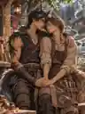
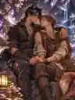
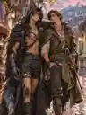
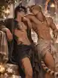
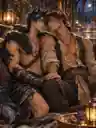

# Portraits — Soren et les hommes de sa vie

Les images ci-dessous sont **sept compositions de duo** réalisées à partir des descriptions de la campagne, avec des tenues adaptées à leur époque. **Elles illustrent une dynamique et un souvenir**, mais ne prouvent pas qu'une séance de pose ou que les gestes exacts de l'image se sont produits dans le récit. Les portraits officiels **individuels** restent les références canoniques pour les traits, couleurs et équipements.

## 1. Soren et [[Thorek|Thorek]] — Amour d'enfance et attachement durable

**Période et décor :** Enfance, J0, dernière confidence J+20 — Varkhûn. **Tenue de Soren :** Tenue de Varkhûn d'avant le départ : cuir et étoffes pratiques, sans cape de Corvin. **Intention artistique :** Proximité protectrice et tendresse ancienne, sans présenter une réunion récente comme une scène réellement jouée.

**Relation actuelle :** À Varkhûn ; aucune nouvelle rencontre depuis le départ de Soren.

**Références :** [[10 — Harem/Fiches/Thorek — Lien avec Soren|Fiche de lien]] · [[Thorek]].

## 2. Soren et [[Narek|Narek de Varkhûn]] — Ancienne relation tendre et intime, non exclusive

**Période et décor :** J−3 à J+1 — Varkhûn. **Tenue de Soren :** Tenue simple et pratique du village, avant les acquisitions de Rochebrune et d'Aethérion. **Intention artistique :** Complicité calme autour du ruisseau et de la cabane ; le tablier rappelle sa vie d'apprenti charpentier.

**Relation actuelle :** Au village, séparé géographiquement de Soren ; reprise de contact non jouée.

**Références :** [[10 — Harem/Fiches/Narek de Varkhûn — Lien avec Soren|Fiche de lien]] · [[Narek]].

## 3. Soren et [[Erynn|Erynn]] — Romance avant le départ ; souvenirs et distance

**Période et décor :** J−7 à J−3 — Lornac / caravane marchande. **Tenue de Soren :** Tenue de voyage plus soignée pour le dîner romantique J−4, antérieure à la cape noire. **Intention artistique :** Dîner dans la grotte cristalline, atmosphère tendre et nostalgique.

**Relation actuelle :** Reparti avec la caravane J−3. Aucune retrouvaille documentée.

**Références :** [[10 — Harem/Fiches/Erynn — Lien avec Soren|Fiche de lien]] · [[Erynn]].

## 4. Soren et [[Tévan|Tévan]] — Amitié privilégiée après une ancienne romance

**Période et décor :** J+2 à J+20 — Aethérion. **Tenue de Soren :** Équipement noir actuel de Soren : harnais à capuche adapté aux oreilles, short en cuir et longue cape de fourrure noire ; Tévan en tenue de duelliste verte et brune. **Intention artistique :** Promenade amicale et proximité des épaules, plutôt qu'une mise en scène d'un couple exclusif.

**Relation actuelle :** Ami proche, soutien mutuel et tendresse consentie ; **ils ne sont pas en couple**.

**Références :** [[10 — Harem/Fiches/Tévan — Lien avec Soren|Fiche de lien]] · [[Tévan]].

## 5. Soren et [[Narek (Aethérion)|Narek d'Aethérion]] — Flirt et rencontre intime ponctuelle

**Période et décor :** J+15 — Aethérion, bains de la Guilde. **Tenue de Soren :** Tenue de bains appropriée à J+15 (drapés, serviettes), sans représenter une nudité explicite. **Intention artistique :** Regard joueur et proximité légère dans une ambiance thermale, sans promesse sentimentale.

**Relation actuelle :** Séparation cordiale ; pas de nouveau rendez-vous.

**Références :** [[10 — Harem/Fiches/Narek d'Aethérion — Lien avec Soren|Fiche de lien]] · [[Narek (Aethérion)]].

## 6. Soren et [[Rhaïven Merath|Rhaïven Merath]] — Attirance mutuelle récente et intimité confirmée

**Période et décor :** J+19 à début J+21 — Aethérion, La Porte de l'Aube et domaine privé. **Tenue de Soren :** Tenue noire actuelle ou vêtements de détente après bains privés ; ambiance du domaine, J+20. **Intention artistique :** Tendresse récente et rapprochement mutuel, sans appropriation ni couple proclamé.

**Relation actuelle :** Ils se sont endormis côte à côte vers 00 h 25 au début de J+21 ; **réveil non joué**.

**Références :** [[10 — Harem/Fiches/Rhaïven Merath — Lien avec Soren|Fiche de lien]] · [[Rhaïven Merath]].

## 7. Soren et [[Caëlan d’Aurevane|Caëlan d'Aurevane]] — Romance naissante, rythme volontairement lent

**Période et décor :** J+20 — Aethérion, cour royale. **Tenue de Soren :** Tenue noire actuelle et longue cape de fourrure de Soren ; habits princiers de Caëlan lors de leur rencontre. **Intention artistique :** Baisers et tendresse dans un cadre princier ; composition retenue correspondant à une attirance nouvelle.

**Relation actuelle :** Un rendez-vous dans ses appartements au château est fixé **J+21 à 18 h**, mais n'a pas encore eu lieu.

**Références :** [[10 — Harem/Fiches/Caëlan d'Aurevane — Lien avec Soren|Fiche de lien]] · [[Caëlan d’Aurevane]].

> [!note] Résolution
> Ces fichiers WebP sont des **vignettes d'affichage**. Les versions PNG en haute définition ont été livrées séparément ; si elles sont ajoutées plus tard au dépôt, conserver les mêmes références et ne pas réécrire les événements historiques sur la base d'une illustration.

[[10 — Harem/README|Accueil du harem]] · [[Index des illustrations|Index général des portraits]]
