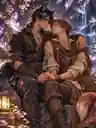

# Soren & Erynn

> [!info] Romance avant le départ ; souvenirs et distance
> **Dernier état :** Reparti avec la caravane J−3. Aucune retrouvaille documentée.

**Personnage officiel :** [[Erynn|Erynn]] · **Dernière période documentée :** J−7 à J−3.  
**Contexte :** Lornac / caravane marchande.

## Historique réel

Jeune Homme-bête Renard et apprenti marchand. Rencontre au marché de Varkhûn à J−7, flirt réciproque, premiers baisers J−6/J−5 puis dîner, danse et baisers J−4 dans la grotte secrète aux cristaux. Erynn offre un bracelet noir tressé de fils bleus et argentés avant son départ ; date exacte du cadeau incertaine.

## Position actuelle et limites

Erynn souhaite progresser lentement. Le bracelet est un souvenir tangible, **pas un contrat de relation exclusive** ni la preuve de sentiments actuels après la séparation.

## Lecture du portrait

**Tenue de Soren :** Tenue de voyage plus soignée pour le dîner romantique J−4, antérieure à la cape noire.

**Intention de l'illustration :** Dîner dans la grotte cristalline, atmosphère tendre et nostalgique.

Il s'agit d'une illustration commémorative/interprétative et non d'une nouvelle scène jouée. Pour les couleurs, anatomies et vêtements canoniques précis, consulter les portraits individuels du [[Index des illustrations|répertoire officiel]].

## Sources du récit

[[Erynn]] · [[J-4 — 8 Floréane 427 — Historique]] · [[J-3 — 9 Floréane 427 — Historique]]

[[00 — Tableau général du harem|Tableau]] · [[01 — Chronologie sentimentale|Chronologie]] · [[02 — Galerie des portraits de duo|Galerie]] · [[10 — Harem/README|Accueil de la rubrique Harem]]
