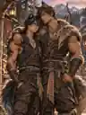
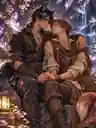
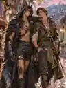
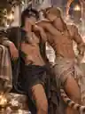
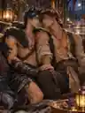
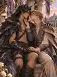

# ♡ 10 — Harem de Soren

> [!info] Registre sentimental — dernière situation jouée
> **Début J+21, 2 Clairvent 427, vers 00 h 25.** Soren dort aux côtés de [[Rhaïven Merath]] dans son domaine ; le réveil n'a pas été joué. Le nom « harem » est un **titre de classement ludique**, et non une institution ni la propriété des partenaires. Toutes ces personnes conservent leur libre arbitre.

## Accès rapides depuis GitHub

| Page | Description |
|---|---|
| [Tableau général](00%20%E2%80%94%20Tableau%20g%C3%A9n%C3%A9ral%20du%20harem.md) | Les sept relations et leurs états |
| [Chronologie sentimentale](01%20%E2%80%94%20Chronologie%20sentimentale.md) | Rencontres, séparations, évolutions datées |
| [Galerie des portraits de duo](02%20%E2%80%94%20Galerie%20des%20portraits%20de%20duo.md) | Sept images de Soren avec chaque homme |
| [Situation actuelle et limites](03%20%E2%80%94%20Situation%20actuelle%20et%20limites.md) | État J+21, non-exclusivité et consentement |
| [Entourage masculin hors harem](04%20%E2%80%94%20Entourage%20masculin%20hors%20harem.md) | Amis et flirts non confirmés |

## Ouvrir les rubriques

| Section | Contenu |
|---|---|
| [[00 — Tableau général du harem]] | Les sept hommes, statuts confirmés et liens individuels |
| [[01 — Chronologie sentimentale]] | Du passé de Varkhûn au début de J+21 |
| [[02 — Galerie des portraits de duo]] | Sept portraits de Soren avec chaque homme |
| [[03 — Situation actuelle et limites]] | Relations ouvertes, limites, suites non jouées |
| [[04 — Entourage masculin hors harem]] | Amis, connaissance et flirts sans romance confirmée |
| [[Index — Personnages et PNJ]] | Biographies et portraits canoniques individuels |

## Les portraits de duo

| Portrait | Relation | Ouvrir |
|---|---|---|
|  | **Thorek** | [Voir la fiche](Fiches/Thorek%20%E2%80%94%20Lien%20avec%20Soren.md) |
|  | **Narek de Varkhûn** | [Voir la fiche](Fiches/Narek%20de%20Varkh%C3%BBn%20%E2%80%94%20Lien%20avec%20Soren.md) |
|  | **Erynn** | [Voir la fiche](Fiches/Erynn%20%E2%80%94%20Lien%20avec%20Soren.md) |
|  | **Tévan** | [Voir la fiche](Fiches/T%C3%A9van%20%E2%80%94%20Lien%20avec%20Soren.md) |
|  | **Narek d'Aethérion** | [Voir la fiche](Fiches/Narek%20d'Aeth%C3%A9rion%20%E2%80%94%20Lien%20avec%20Soren.md) |
|  | **Rhaïven Merath** | [Voir la fiche](Fiches/Rha%C3%AFven%20Merath%20%E2%80%94%20Lien%20avec%20Soren.md) |
|  | **Caëlan d'Aurevane** | [Voir la fiche](Fiches/Ca%C3%ABlan%20d'Aurevane%20%E2%80%94%20Lien%20avec%20Soren.md) |

## Repères essentiels

- **Sept rapprochements affectifs ou intimes confirmés**, **aucun couple exclusif formalisé**.
- **[[Thorek]]** : attachement ancien d'une intensité particulière, évoqué par Soren comme une possible relation durable à J+20.
- **[[Tévan]]** : ancienne romance, devenue **amitié** depuis la clarification explicite de J+15 ; la tendresse postérieure ne rétablit pas un couple.
- **[[Rhaïven Merath]]** : intimité récente mais statut d'employé inchangé.
- **[[Caëlan d’Aurevane]]** : attirance réciproque, avance prudente et rendez-vous J+21 à 18 h **non joué**.
- **Deux Narek, deux individus** : [[Narek]] de Varkhûn et [[Narek (Aethérion)]].

## Interprétation des illustrations

Les sept images de duo représentent **l'histoire et le type de relation**, sans constituer des photographies de scènes documentaires. Les gestes, cadrages et décors sont des **compositions artistiques**, non des événements ajoutés au jeu. Les vêtements ont été choisis selon **l'époque de la rencontre** : village avant Corvin, tenue noire actuelle après la cape, ou vêtements de bains lorsque pertinent. Les portraits **individuels officiels** rangés sous [[Index des illustrations]] restent prioritaires pour l'identité et les détails physiques.

> [!note] Format d'images
> Les fichiers WebP présents dans ce dossier sont des **vignettes légères pour Obsidian/GitHub** ; les sept compositions originales en haute définition sont conservées séparément dans le paquet fourni avec la création de cette rubrique. Ne pas confondre la miniature et la résolution source.

## Source et mise à jour

[[État de reprise J+21]] · [[Chronologie générale]] · [[Index — Relations]] · [[16 - Relations importantes]].

Les relations ne sont **pas des scores officiels** ; ne jamais inventer des jauges d'amour, de jalousie, d'exclusivité ou des pensées de PNJ. Pour toute évolution jouée, consigner d'abord la scène dans le journal, puis actualiser le statut de la fiche individuelle et de ce registre.
